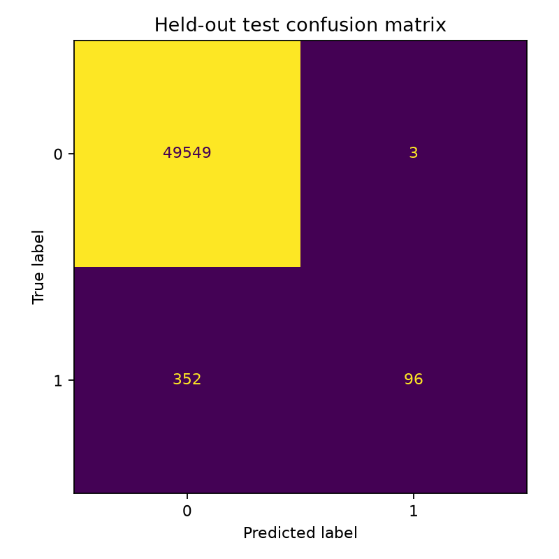
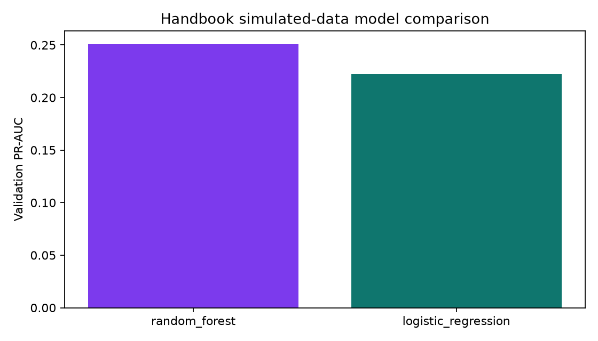
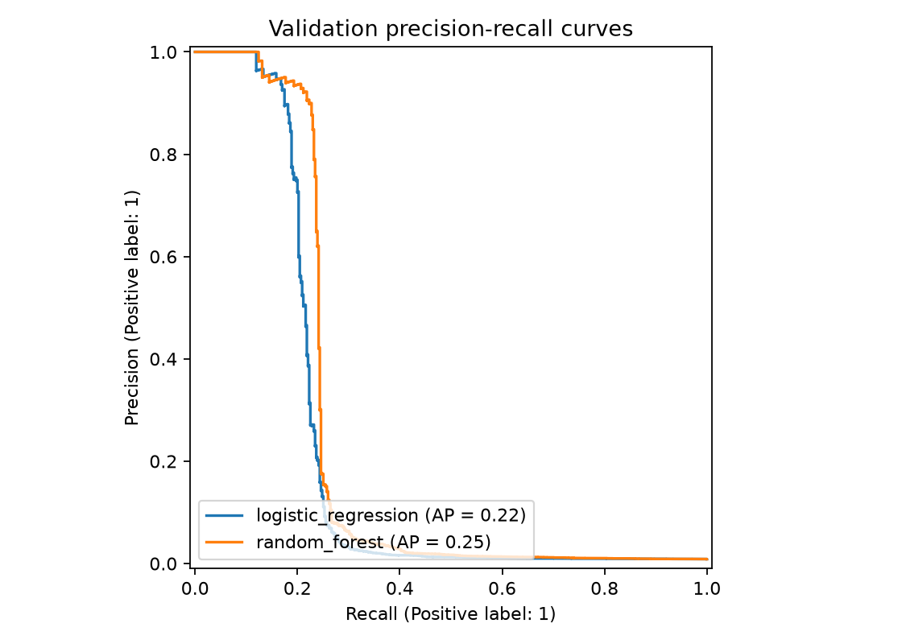
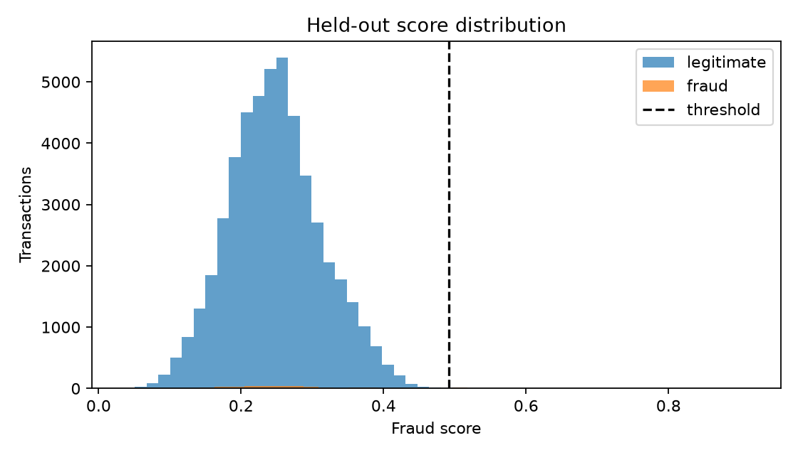

# Evaluation

After training, open the [outputs folder](../outputs/) to find:

- `model_comparison.csv`
- `metrics.json`
- `dataset_profile.json`
- `test_predictions.csv`
- `model_comparison.png`
- `precision_recall_curves.png`
- `confusion_matrix.png`
- `prediction_distribution.png`

Run `python evaluation/evaluate.py` to print the held-out results in the terminal.

## Current real-data run

Random forest was selected by validation PR-AUC. On the 50,000-row held-out test sample it achieved
PR-AUC 0.2511, ROC-AUC 0.6316, precision 0.9697, and recall 0.2143.

### Confusion matrix

### Model comparison

### Precision-recall curves

### Prediction distribution

